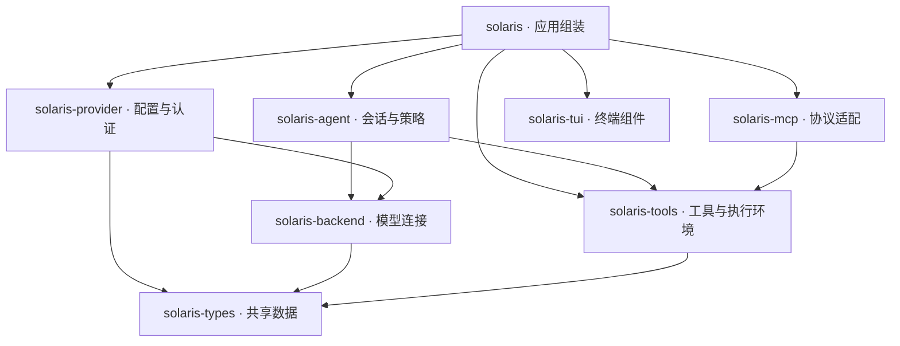
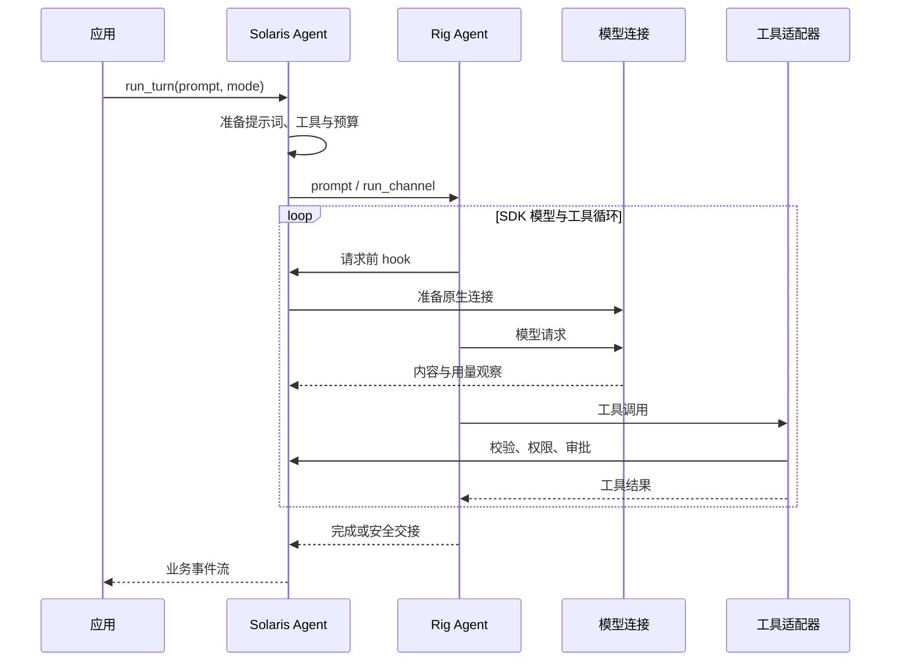

# Solaris 架构

本文描述当前代码实现，是仓库唯一的项目说明文档。Solaris 是基于 Rust、官方 Rig SDK 和 Ratatui 的终端 AI 助手，提供交互式 TUI 与 headless 入口。

## 1. 模块与依赖

Cargo workspace 包含八个 crate，使用 Rust edition 2024，核心 crate 的最低 Rust 版本为 1.97.1。生产代码依赖方向如下；测试依赖不计入图中。



| Crate | 职责 | 主要入口 |
| --- | --- | --- |
| `solaris` | CLI/TUI、配置加载、认证交互、服务组装、应用状态与转录展示 | `main.rs`、`assembly.rs`、`app.rs`、`automation.rs` |
| `solaris-provider` | 连接预设、用户端点、官方模型事实解析、凭据存储与刷新、远程模型列表 | `config.rs`、`selection.rs`、`credentials/`、`discovery.rs` |
| `solaris-backend` | Rig 原生模型连接、协议选择、HTTP 策略、有限重试、业务消息与事件类型 | `lib.rs`、`connection.rs`、`client.rs`、`request.rs` |
| `solaris-agent` | 会话入口、SDK 执行器集成、审批、预算、队列、压缩、子代理、持久化 | `agent.rs`、`driver.rs`、`session.rs`、`conversation.rs` |
| `solaris-tools` | 工具注册与选择、Bash 执行环境、文件操作、搜索、输出截断与变更记录 | `lib.rs`、`environment.rs`、`runner.rs`、`tools/` |
| `solaris-mcp` | MCP 连接、发现、资源与提示词操作、工具适配 | `lib.rs` |
| `solaris-tui` | 组件、布局、输入、浮层、主题、终端生命周期 | `lib.rs` |
| `solaris-types` | 能力状态、工具状态、附件、截断与变更等共享数据 | `lib.rs` |

应用负责组装：选择 provider、准备 agent 后端配置、建立 MCP 连接并显式注册工具。agent 不依赖 provider 或应用；MCP 不修改工具注册表。TUI 框架不承担模型执行和会话策略。

## 2. Rig 与 Solaris 的责任边界

模型与执行使用官方 `rig-core`、`rig-reqwest`、`rig-agent` 和 `rig-memory` 0.46.0，没有项目内 vendor 副本。

| 能力 | 实现归属 |
| --- | --- |
| 厂商方言、请求序列化、HTTP 流解码、原生模型响应 | Rig |
| 模型与工具的多轮执行、工具调度、任务成功时保存 memory | Rig Agent |
| 消息身份、配对规范化、memory 存储、上下文估算与压缩规划 | Rig Core / Memory |
| 端点选择、凭据持久化、刷新协调、产品头和网关兼容策略 | Solaris provider / backend |
| 工具权限、参数校验、审批、执行预算、steering / follow-up | Solaris agent，通过 SDK 接口与 hook 接入 |
| 业务转录、工具意图、计费账本、子代理管理、UI 投影 | Solaris |

Solaris 只保留一个生产模型入口：`AgentBackend::model_client()` 返回 `ModelClient`。它携带固定能力、原生 Serve handler 及结算/状态观察器。`Backend` 是生产模型连接实现；认证、预算和账本通过包装连接准备或观察结算工作，不提供另一套模型执行循环。

业务 `Message`、`ToolCall`、`ToolResult` 和 `AgentEvent` 用于工具边界、journal 与展示。它们与 Rig 类型之间的转换不是第二个模型后端。`test-utils` 仅由开发依赖启用，提供 Rig handler 和 HTTP 测试夹具。

## 3. Provider 与模型连接

### 配置和模型事实

`ProviderConfig` 持有不可变的官方 Catalog 及用户覆盖。模型参数、能力和价格事实来自 Rig 官方数据；Solaris 没有独立模型快照、外部 models.dev 下载器或 token 价格计算器。目录更新随 SDK 依赖更新。

配置分别表达端点、请求模型 ID 和元数据身份，允许网关别名显式绑定官方模型。未知或有歧义的模型事实保持未知，不通过名称前缀猜测能力。模型选择器读取官方目录及用户命名模型。

`selection.rs` 在选择连接时解析模型，生成不可变 `ModelParameters` 和 `TurnPlan`。请求模型名、能力、上下文限制及输出预算由同一份事实派生。内置 provider 与自定义端点共用连接组装函数；认证方式和端点路由在组装前确定。

远程模型发现与官方元数据目录是两项独立操作：前者查询账号可见的模型 ID，允许缓存与离线回退；后者提供模型能力和标准价格事实。

### 认证和请求

API 凭据与订阅凭据分开管理。ChatGPT 浏览器认证和令牌交换使用官方 Authenticator；Solaris 负责交互期限、持久化和共享刷新协调。父子连接共享刷新状态，轮换令牌保存失败时保留新令牌并重试保存。自定义端点不能接收订阅令牌。

后端使用官方模型、方言、ModelAdapter 和 Serve handler。请求策略保留首个内容到达前的有限重试、Retry-After、明确网关拒绝后的兼容修正，以及产品会话头。已收到内容或无法确认可安全重试的载荷后不重放请求。HTTP 连接池复用；Solaris 不自行解析 SSE 或重新实现厂商协议。

## 4. 会话执行与安全边界



`driver.rs` 通过 `AgentBuilder`、hook、ToolServer 和 `run_channel()` 集成完整 SDK 执行器。SDK 负责模型—工具—模型循环；host 外层协调任务阶段、steering、后台完成通知与压缩，不逐轮重建或手动驱动模型请求。

需要改变当前请求历史时，host 在下一次模型请求前建立安全交接：保存已配对的 SDK 原生历史、核对取消返回的规范历史，再交接后续阶段。检查保存游标可拒绝并发写入。普通失败和取消不保存当前未提交阶段；此前成功或安全交接的消息继续保留。

- **steering**：在请求边界插入纠正信息，不打断已经执行的工具。
- **follow-up**：当前任务之后开始后续任务。
- **工具执行**：校验 JSON 参数与工具 schema，应用模式、权限及审批；拒绝或执行错误作为工具反馈交给 SDK。
- **输出截断**：残缺工具调用被拒绝，模型获得重新提交完整参数的反馈；不会执行半个调用。
- **取消**：取消模型执行及可取消的工具进程，不回滚已经发生的文件或外部副作用。
- **预算**：父任务、摘要和子代理共享请求次数、期限与费用约束。

单个会话通过 turn lease 限制一个活动轮次。UI 事件通过持久化边界输出；journal 写入失败会停止流并报告错误。

## 5. 消息、持久化与恢复

模型历史唯一来源是官方 memory：临时会话使用 MemoryStore，持久会话使用 `sessions/memory/<SESSION_ID>` 下的 DirStore。不存在另一份独立 SDK 会话历史，也不从 UI 转录重建模型历史。

SQLite journal 保存产品事件、工具意图、模型选择、请求用量、子任务和执行元数据。它不是模型消息存储；旧 SQL 上下文和旧消息日志不再导入。历史费用只从逐请求账本恢复，不从累计 `TurnComplete` 事件回推。

恢复直接打开 native memory，并由 Rig `normalize()` 修复工具配对。Solaris 只为 SDK 补齐的缺失工具结果添加中断提示，要求核查副作用后再尝试。修复保留消息身份，重复恢复不会重复补结果，也不会重新执行工具。

分叉复制原生消息、消息 ID 和压缩旁注到独立 memory，使用目标存储自己的保存游标。产品记录另行复制，后续父子修改互不影响。持久会话有执行租约，防止多个进程同时占用。

模型 history、转录和费用的提交边界不同：失败阶段可能没有进入 memory，但已经发生的工具意图、展示事件与费用仍会保留。恢复不等于重放副作用。两个存储均应视为敏感数据。

## 6. 上下文、压缩与计费

### 上下文投影

`projection.rs` 使用官方 `Prepared`、`RequestStart`、`Anchor` 与 `next_request_tokens` 计算当前请求占用。它引用 SDK 活动历史的共享原生消息，只计算投影，不另写一份模型历史。

可复用的请求锚点使用实测用量加其后新增内容的估算；模型、提示词、工具集合或历史变化会使旧锚点失效。工具变化重算当前工作视图，UI 和预算读取同一计算结果。恢复后的会话重新估算，不用累计账单代替单次请求上下文。

规则和技能加载时准备模型可见路径。资源与工具估算输入在内存中缓存，查询上下文不读文件、不启动 Bash、不重建提示词。应用重载资源在后台串行准备，空闲边界发布。

### 压缩

压缩使用官方清理策略、合法切点、摘要规划与持久摘要状态。只有有效摘要产生后，清理和摘要才一起提交；失败不会提交半成品。自动压缩可在完整工具批次后的请求边界交接。系统提示词来自当前资源，不混入待摘要消息。摘要是一次真实模型请求，计入预算和账本。

### 用量和费用

普通输入、输出、缓存读、缓存写经统一转换保留为业务用量。缺少上游用量时允许标记为估算；费用仍只读取原生响应的 `usage.cost`，不按估算 token 回退计价。

结算观察器保留完整 SDK `Cost`，包括缺失状态和完整性标记。`UsageTotals.cost_usd` 是已知费用小计，`cost_complete` 表示全部请求费用是否完整；部分或未知费用不会被当成完整的零费用。启用费用预算时，无法获得完整费用会停止执行。

账本逐请求记录，摘要及子代理的已发生消耗在失败或取消后仍可恢复。子请求先写入父账本，后交付完成通知；父任务吸收子任务结果只更新轮次累计，避免重复记账。子代理占用不计入父模型上下文。

当前应用事件和 UI 仍展示标量费用小计，尚未展示核心费用完整性状态。Rig 标准 API 参考价也不等于实际账单，订阅连接不套用 API 价格。

## 7. 子代理与后台任务

子代理拥有隔离的会话 memory，复用工具策略、模型连接与共享执行预算，并受并发限制。可以指定模型或通过恢复 ID 显式继续子会话。

前台委托等待子任务完成，将结果作为当前工具结果返回父任务。后台委托先返回任务标识，由后台管理器保留状态和完成结果；父任务在安全边界吸收完成通知。SDK 负责子会话内的模型/工具执行，Solaris 负责任务生命周期、父子关联、通知与产品记录。

取消和失败不会丢弃已经结算的子请求消耗。子任务结果与状态不构成父会话的第二份模型历史。

## 8. 工具与执行环境

所有面向模型的命令和用户文件操作统一经过 Bash。`read`、`write`、`edit`、`ls`、`grep`、`find` 与 `bash` 工具使用系统程序或固定脚本；Rust 负责进程管理、数据传递、校验和结果包装。应用配置、memory 和 journal 等内部持久化仍由 Rust/SDK 管理。

```text
工具 → ExecutionEnvironment → Bash → 执行脚本或 exec "$@" → 捕获结果
```

- **Linux/macOS**：使用系统 Bash、系统 PATH 与 POSIX 路径。
- **Windows**：启动随包 Cygwin Bash，禁用个人启动文件，显式加载 `/etc/profile`；PATH 固定为 `/usr/local/bin:/usr/bin:/bin`。系统盘通过 `/cygdrive/<letter>/` 访问，面向 agent 描述 Cygwin 环境。
- **脚本与参数**：结构化工具的参数作为独立位置参数传递，不拼入脚本。文件内容走 stdin。Windows 将脚本、参数数量和参数以 NUL 分帧写入 stdin，后接原始文件数据；原生 argv 只携带固定 dispatcher，防止 Cygwin 启动时的 glob 和反斜杠处理破坏正则或参数。
- **进程**：每次调用建立子进程并捕获输出，不依赖持久交互式终端。取消与超时按执行环境管理子进程。
- **文件变更**：固定脚本处理路径规范化、替换、临时文件与同步；串行化冲突写入，保留哈希及 diff 供审阅和撤销。原子替换不代表业务级回滚。
- **搜索与输出**：`grep`、`find` 分别调用 `rg`、`fd`；输出按工具策略截断，并通过附件路径保留需要的完整输出。

Windows 启动校验 `cygwin.rs::REQUIRED_FILES`，覆盖 Bash、Cygwin DLL、profile、路径转换、文件操作和搜索程序。校验不把 Cygwin 目录注入宿主 Windows PATH；工具查找在统一 Bash 环境内完成。HOME 和 TMPDIR 指向用户可写位置。

这保证工具默认使用 Cygwin PATH，不构成阻止任意脚本显式运行宿主程序的操作系统沙箱。

## 9. MCP 与展示

`McpManager::connect()` 建立服务器连接并发现工具；应用取得适配器并注册到工具表。资源、资源模板和提示词操作同样映射成工具，经过统一权限、审批和预算路径。工具适配器持有连接引用，连接随最后一个持有者释放。单个服务器失败以诊断报告，不替代本地工具执行。

应用层负责命令、对话状态、转录、终端输入与认证交互；`solaris-tui` 提供可复用组件框架。Markdown 使用官方 `tui-markdown` 依赖，并在展示层适配所需样式。流式思考、文本和工具事件由 agent hook 产生，应用维护展示投影，展示数据不作为 SDK 工作历史。

应用层目前仍集中承担较多组装、状态和展示职责，本批核心清理没有拆分应用层。

## 10. 验证与扩展

```bash
cargo fmt --all -- --check
cargo test --workspace --all-features --locked
cargo clippy --workspace --all-targets --all-features --locked -- -D warnings
cargo +1.97.1 check --workspace --all-targets --all-features --locked
cargo check --workspace --lib --bins --locked
```

测试覆盖原生 SDK 请求、流事件、取消、审批、工具参数、费用状态、压缩、恢复与分叉、子代理、认证刷新及 TUI。HTTP 与回调测试使用本地夹具，不依赖真实模型账号。

扩展优先沿现有边界进行：新工具实现工具接口，由应用注册；新 MCP 能力提供适配器；新厂商优先使用 Rig 官方连接与方言；模型事实使用官方目录/覆盖；执行策略通过 SDK hook 或连接观察器接入。避免恢复独立协议客户端、第二份 history、独立计价器或逐轮模型驱动循环。

## 附录：随包 Cygwin 工具来源

`bin/readlink.exe` 与 `bin/sync.exe` 提取自官方 Cygwin coreutils 9.0-1 包。readlink 用于审批与变更路径的符号链接规范化；目录使用 Bash `cd -P`。原子替换在 rename 前同步临时文件、之后同步父目录；Linux 使用 GNU 单文件 sync，macOS/Cygwin 使用全局同步屏障。

- 二进制包：<https://mirrors.kernel.org/sourceware/cygwin/x86_64/release/coreutils/coreutils-9.0-1.tar.xz>
- SHA-512：`530f47640d878f5953580f3556c492a93786191abe573322026b70206a46c7f17d05927784db3e7f2c044d1555f35941880316f7288b887eaec770a9eda4c687`
- 对应源码：<https://mirrors.kernel.org/sourceware/cygwin/x86_64/release/coreutils/coreutils-9.0-1-src.tar.xz>
