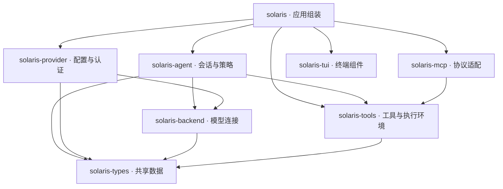
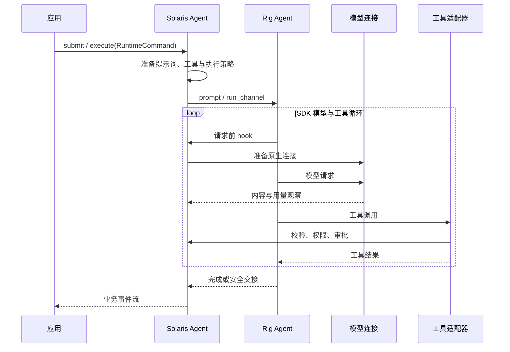

# Solaris 架构

本文描述当前代码实现，与 README 一起说明项目的行为与边界。Solaris 是基于 Rust、官方 Rig SDK 和 Ratatui 的终端 AI 助手，提供交互式 TUI 与 headless 入口。

## 1. 模块与依赖

Cargo workspace 包含八个 crate，使用 Rust edition 2024，核心 crate 的最低 Rust 版本为 1.97.1。生产代码依赖方向如下；测试依赖不计入图中。



| Crate | 职责 | 主要入口 |
| --- | --- | --- |
| `solaris` | CLI/TUI、配置加载、认证交互、服务组装、应用状态与转录展示 | `main.rs`、`assembly.rs`、`app.rs`、`automation.rs` |
| `solaris-provider` | 连接预设、用户端点、官方模型事实解析、凭据存储与刷新、远程模型列表 | `config.rs`、`selection.rs`、`credentials/`、`discovery.rs` |
| `solaris-backend` | Rig 原生模型连接、协议选择、HTTP 策略、有限重试、请求用量与消息边界转换 | `lib.rs`、`connection.rs`、`client.rs`、`request.rs` |
| `solaris-agent` | 会话入口、SDK 执行器集成、审批、任务调度、队列、压缩、子代理、持久化 | `runtime/`、`execution/`、`policy/`、`context/`、`tasks/`、`storage/` |
| `solaris-tools` | 工具注册与选择、Bash 执行环境、文件操作、搜索、输出截断与变更记录 | `lib.rs`、`environment.rs`、`runner.rs`、`tools/` |
| `solaris-mcp` | MCP 连接、发现、资源与提示词操作、工具适配 | `lib.rs` |
| `solaris-tui` | 组件、布局、输入、浮层、主题、终端生命周期 | `lib.rs` |
| `solaris-types` | 工具声明/调用/结果、能力状态、附件、截断与变更等共享数据 | `lib.rs` |

应用负责组装：选择 provider、准备 agent 后端配置、建立 MCP 连接并显式注册工具。agent 不依赖 provider 或应用；MCP 不修改工具注册表。TUI 框架不承担模型执行和会话策略。

## 2. Rig 与 Solaris 的责任边界

模型与执行使用官方 `rig-core`、`rig-reqwest`、`rig-agent` 和 `rig-memory` 0.46.0，没有项目内 vendor 副本。

| 能力 | 实现归属 |
| --- | --- |
| 厂商方言、请求序列化、HTTP 流解码、原生模型响应 | Rig |
| 模型与工具的多轮执行、工具调度、任务成功时保存 memory | Rig Agent |
| 消息身份、配对规范化、memory 存储、上下文估算与压缩规划 | Rig Core / Memory |
| 端点选择、凭据持久化、刷新协调、产品头和网关兼容策略 | Solaris provider / backend |
| 工具权限、参数校验、审批、执行步数、steering / follow-up | Solaris agent，通过 SDK 接口与 hook 接入 |
| 业务转录、工具意图、计费账本、子代理管理、UI 投影 | Solaris |

Solaris 只保留一个生产模型入口：`ModelConnector::model_client()` 返回 `ModelClient`。它携带固定能力、原生 Serve handler 及单一结算回调与状态通知。`Backend` 是生产模型连接实现；认证由 provider 的连接工厂协调，执行策略和账本通过 agent 的统一执行连接准备与结算流程工作，不提供另一套模型执行循环。

`AgentEvent` 属于 agent，工具调用数据契约属于 `solaris-types`，并由 tools 暴露。通用 `Message` / `Role` / `Content` 及双向转换仅在测试功能中提供；生产边界直接转换工具内容和图片，后台通知直接构造原生消息。`ToolCall`、`ToolResult` 和 `AgentEvent` 用于工具边界、journal 与展示。它们与 Rig 类型之间的转换不是第二个模型后端。`test-utils` 仅由开发依赖启用，提供 Rig handler 和 HTTP 测试夹具。

## 3. Provider 与模型连接

### 配置和模型事实

`ProviderConfig` 持有不可变的官方 Catalog 及用户覆盖。模型参数、能力和价格事实来自 Rig 官方数据；Solaris 没有独立模型快照、外部 models.dev 下载器或 token 价格计算器。目录更新随 SDK 依赖更新。

配置分别表达端点、请求模型 ID 和元数据身份，允许网关别名显式绑定官方模型。未知或有歧义的模型事实保持未知，不通过名称前缀猜测能力。模型选择器读取官方目录及用户命名模型。

`selection.rs` 在选择连接时解析模型，生成不可变 `ModelParameters` 和 `TurnPlan`。请求模型名、能力、上下文限制及输出预算由同一份事实派生。内置 provider 与自定义端点共用连接组装函数；认证方式和端点路由在组装前确定。

远程模型发现与官方元数据目录是两项独立操作：前者由 provider 的 `ModelSource` 查询账号可见的模型 ID，允许缓存与离线回退；后者提供模型能力和标准价格事实。执行连接不再提供模型列表查询或列表诊断。

### 认证和请求

API 凭据与订阅凭据分开管理。ChatGPT 浏览器认证和令牌交换使用官方 Authenticator；Solaris 负责交互期限、持久化和共享刷新协调。父子连接共享刷新状态，轮换令牌保存失败时保留新令牌并重试保存。自定义端点不能接收订阅令牌。

后端使用官方模型、方言、ModelAdapter 和 Serve handler。请求策略保留首个内容到达前的有限重试、Retry-After、明确网关拒绝后的兼容修正，以及产品会话头。已收到内容或无法确认可安全重试的载荷后不重放请求。HTTP 连接池复用；Solaris 不自行解析 SSE 或重新实现厂商协议。

## 4. 会话执行与安全边界



`execution/driver.rs` 通过 `AgentBuilder`、hook、ToolServer 和 `run_channel()` 集成完整 SDK 执行器。SDK 负责模型—工具—模型循环；host 外层协调任务阶段、steering、后台完成通知与压缩，不逐轮重建或手动驱动模型请求。

需要改变当前请求历史时，host 在下一次模型请求前建立安全交接：保存已配对的 SDK 原生历史、核对取消返回的规范历史，再交接后续阶段。检查保存游标可拒绝并发写入。普通失败和取消不保存当前未提交阶段；此前成功或安全交接的消息继续保留。

- **steering**：在请求边界插入纠正信息，不打断已经执行的工具。
- **follow-up**：当前任务之后开始后续任务。
- **工具执行**：校验 JSON 参数与工具 schema，应用模式、权限及审批；拒绝或执行错误作为工具反馈交给 SDK。
- **输出截断**：残缺工具调用被拒绝，模型获得重新提交完整参数的反馈；不会执行半个调用。
- **取消**：取消模型执行及可取消的工具进程，不回滚已经发生的文件或外部副作用。
- **步数**：默认不限制请求次数或执行时长；可设置 `steps`，最后一步撤下全部工具并请求总结。父子独立计数；新用户输入开始新的执行阶段。委托深度单独控制，默认一层。

`SessionRuntime` 的单一处理任务串行接收发送、取消、插话、排队、清空、压缩、资源替换和连接切换等命令。`submit()` 同步入队并返回接受回执，`execute()` 等待接受结果；调用方消费带元数据的事件流，或通过 `subscribe()` 订阅，通过 `snapshot()` 查询状态。运行时不再 Deref 为 Agent，也没有启动前的 `configure()` 命令分支。初始资源通过构造阶段注入；运行时命令统一入队，并在状态更新后回复接受回执。

应用使用 `dispatch()` 提交由 Runtime 持有生命周期的操作，回执返回接受时刻的快照和执行标识；订阅者退出不会隐式取消这些操作。`submit()/execute()` 保留按调用消费的便利事件流，丢弃它会取消对应执行，供 CLI 等调用方使用。TUI 不再创建消费并丢弃正常事件的任务；取消通过命令表达。资源和连接替换在繁忙期间排队，在空闲边界应用后才回复接受回执；界面在资源发布获确认后才更新技能和提示。关闭 Runtime 会拒绝新请求、唤醒订阅者并停止后续自动唤醒。

事件包含会话 ID、任务 ID 和会话级递增序号，序号在持久会话恢复后继续增长。快照包含模型、厂商、标签、能力、最近请求模式、两种模式的上下文、活动子任务和费用。界面每次更新读取同一份快照，运行时不再提供另一套逐字段状态 getter。应用侧 TUI、CLI 和 RPC 共用命令入口，模型发现直接使用 provider 服务。

会话租约由实际执行任务持有，便利接口的输出流被丢弃时只触发取消，不提前释放租约。终态交付会等待执行器退场，避免旧任务晚写 memory 与新任务冲突。journal 写入失败会停止流并报告错误。

agent 内部职责按目录组织：

| 目录 | 职责 |
| --- | --- |
| `runtime/` | 会话构造、命令处理、事件、队列和状态投影 |
| `execution/` | Rig hook/handler、固定请求快照、工具桥接和执行连接 |
| `policy/` | 权限、审批、权限规则与执行设置 |
| `context/` | 提示词资源、技能、请求估算和压缩策略 |
| `tasks/` | 前后台子代理、并发、取消和结果交付 |
| `storage/` | native memory、journal、计费账本、执行记录和提交检查点 |

`AgentOptions` 仅包含用户会话配置；资源通过 `with_resources(ResourceSnapshot)` 独立注入。审批策略从原始配置为每个会话构造一次，子代理不会继承已包装的策略实例。共享 Jobs、当前委托深度、子模型工厂与费用报告保存在内部会话服务中，不混入用户配置。应用生命周期的 `Runtime` 持有已加载的 `SessionRuntime` 与 Jobs；切换界面或结束一个父轮次不会销毁后台任务。

## 5. 消息、持久化与恢复

模型历史唯一来源是官方 memory：临时会话使用 MemoryStore，持久会话使用 `sessions/memory/<SESSION_ID>` 下的 DirStore。不存在另一份独立 SDK 会话历史，也不从 UI 转录重建模型历史。

SQLite journal 保存产品事件、工具意图、模型选择、请求用量、子任务和执行元数据。它不是模型消息存储；旧 SQL 上下文和旧消息日志不再导入。历史费用只从逐请求账本恢复，不从累计 `TurnComplete` 事件回推。清空使用独立 `Cleared` 业务记录，不携带另一份消息列表。

恢复直接打开 native memory，并由 Rig `normalize()` 修复工具配对。Solaris 只为 SDK 补齐的缺失工具结果添加中断提示，要求核查副作用后再尝试。修复保留消息身份，重复恢复不会重复补结果，也不会重新执行工具。

分叉复制原生消息、消息 ID 和压缩旁注到独立 memory，使用目标存储自己的保存游标。产品记录另行复制，后续父子修改互不影响。持久会话有执行租约，防止多个进程同时占用。

模型 history、转录和费用的提交边界不同：失败阶段可能没有进入 memory，但已经发生的工具意图、展示事件与费用仍会保留。恢复不等于重放副作用。两个存储均应视为敏感数据。

持久 memory 使用检查点包装器：先向 SQLite 记录待提交的日志范围与摘要，再由原生 Store 执行带游标校验的写入，最后确认提交。恢复时根据已存在的日志字节确认或中止未完成检查点，不补写消息、不执行工具。原子事务不跨越两种存储。

当前会话 schema 为 6；接受新数据库，并从 schema 4/5 增加任务、通知及输入表，其他版本明确拒绝。产品事件和会话序号在同一 SQLite 事务内提交，成功后才发布。保存失败的诊断事件 `sequence` 为 null，不冒充已持久化事件。

新产品事件以 `RuntimeEvent` 完整保存会话、执行标识、序号及已接受提示词。提示词元数据保证快照读取与新请求交错时，后续补读仍能恢复正确轮次。`SessionJournal::history()` 在同一读事务中取得展示记录和水位；`subscribe_from()` 先订阅再按水位补读，过滤重复并检查连续性。持久会话从带序号索引的记录分页补读；临时会话使用有限环形缓存，缓存过期时明确要求重新同步，不静默跳过；TUI 阻止向已失效订阅发送新提示词，用户可取消当前工作并通过 /clear 重建订阅。清空展示须等待 Runtime 成功确认，失败保留原转录。分叉复制事件水位并重绑定会话身份，后续执行标识与历史不冲突。

任务终态与完成通知 outbox 在同一事务内提交。steering、follow-up 和运行中子任务的追加输入持久入队；消费者先提交 native memory，再确认输入或通知。稳定的通知 author ID 用于跨重启去重，避免在 memory 已提交、SQL 确认尚未完成时重复追加。

## 6. 上下文、压缩与计费

### 上下文投影

`context/projection.rs` 使用官方 `Prepared`、`RequestStart`、`Anchor` 与 `next_request_tokens` 计算当前请求占用。它引用 SDK 活动历史的共享原生消息，只计算投影，不另写一份模型历史。

可复用的请求锚点使用实测用量加其后新增内容的估算；模型、提示词、工具集合或历史变化会使旧锚点失效。工具变化重算当前工作视图，UI 和预算读取同一计算结果。每次调用固定 `RequestSnapshot`，模型连接、请求头及工具声明一致；SDK 注册、请求工具集和参数校验使用准备好的工具规格，结算使用该请求保留的计量头。恢复后的会话重新估算，不用累计账单代替单次请求上下文。

规则和技能加载时准备模型可见路径。资源与工具估算输入在内存中缓存，查询上下文不读文件、不启动 Bash、不重建提示词。应用重载资源在后台串行准备，空闲边界发布。

### 压缩

压缩使用官方清理策略、合法切点、摘要规划与持久摘要状态。只有有效摘要产生后，清理和摘要才一起提交；失败不会提交半成品。自动压缩可在完整工具批次后的请求边界交接。系统提示词来自当前资源，不混入待摘要消息。摘要是一次真实模型请求，独立计入本会话账本。

### 用量和费用

普通输入、输出、缓存读、缓存写经统一转换保留为业务用量。缺少上游用量时使用 Rig 原生消息计数器估算请求与回复，包含工具声明和非文本输出，并标记为估算；费用仍只读取原生响应的 `usage.cost`，不按估算 token 回退计价。

结算协调器保留完整 SDK `Cost`，包括缺失状态和完整性标记。每个准备好的模型请求具有独立标识，连接只结算一次，数据库对会话内请求标识建立唯一约束，恢复也按请求去重。固定顺序为：本会话账本持久化、累计值更新、统计发布，不依赖观察器注册顺序。`UsageTotals.cost_usd` 是已知费用小计，`cost_complete` 表示全部请求费用是否完整；部分或未知费用不会被当成完整的零费用。费用未知时继续保留其不完整标记。

账本逐请求记录，摘要及子代理的已发生消耗在失败或取消后仍可恢复。每个子会话只向自己的账本记账，不再向父账本复制请求；前台结果携带独立用量，父轮次可以合并展示。后台结果的费用保存在 JobResult 与子会话账本中。子代理占用不计入父模型上下文。

当前统计 UI 区分完整费用、部分小计及未知费用；轮次事件仍携带便于展示的标量小计，完整状态以核心账本为准。Rig 标准 API 参考价也不等于实际账单，订阅连接不套用 API 价格。

## 7. 子代理与后台任务

前台与后台使用同一份 Job 状态机，包含 job ID、owner/target session ID、run ID、状态、停止原因和结果。前台等待工具结果；后台立即返回 job ID。每个子会话拥有独立 native memory、执行步数与账本，继承权限、项目资源及连接刷新协调器。默认最多一层委托，可通过 `--subagent-depth` 调整。

Jobs 控制运行和取消。并发槽位只覆盖实际模型请求及普通工具执行，不覆盖等待子任务的时间，避免嵌套委托耗尽槽位。一次子会话只有一个执行器；向运行中的子任务追加输入会持久入队，完成检查与输入接收串行化，必要时由同一 Job 继续执行。已结束的子会话通过 resume_id 显式续跑。

后台进度经会话事件边界持久化并发布，不依赖父轮次的输出流。后台完成在父会话的安全请求边界吸收；父会话空闲时自动唤醒。RPC 通过订阅也能收到自动唤醒事件，其 request_id 为 null。通知进入父 native memory 后才确认，不构成另一份模型历史。

普通父轮次取消只停止前台委托；后台需要显式取消指定 Job。应用退出将运行中任务标为 Interrupted，恢复时保留结果和未投递通知，不自动重放工具。已发生的工具副作用与已结算请求不会被回滚。

## 8. 工具与执行环境

所有面向模型的命令和用户文件操作统一经过 Bash。`read`、`write`、`edit`、`ls`、`grep`、`find` 与 `bash` 工具使用系统程序或固定脚本；Rust 负责进程管理、数据传递、校验和结果包装。应用配置、memory 和 journal 等内部持久化仍由 Rust/SDK 管理。

```text
工具 → ExecutionEnvironment → Bash → 执行脚本或 exec "$@" → 捕获结果
```

- **Linux/macOS**：使用系统 Bash、系统 PATH 与 POSIX 路径。
- **Windows**：启动随包 Cygwin Bash，禁用个人启动文件，显式加载 `/etc/profile`；PATH 固定为 `/usr/local/bin:/usr/bin:/bin`。系统盘通过 `/cygdrive/<letter>/` 访问，面向 agent 描述 Cygwin 环境。
- **脚本与参数**：结构化工具的参数作为独立位置参数传递，不拼入脚本。文件内容走 stdin。Windows 将脚本、参数数量和参数以 NUL 分帧写入 stdin，后接原始文件数据；原生 argv 只携带固定 dispatcher，防止 Cygwin 启动时的 glob 和反斜杠处理破坏正则或参数。
- **进程**：每次调用建立子进程并捕获输出，不依赖持久交互式终端。取消与超时按执行环境管理子进程。
- **文件变更**：固定脚本处理路径规范化、替换、临时文件与同步；串行化冲突写入，保留哈希及 diff 供审阅和撤销。原子替换不代表业务级回滚。
- **搜索与输出**：`grep`、`find` 分别调用 `rg`、`fd`；输出按工具策略截断，并通过附件路径保留需要的完整输出。

Windows 启动校验 `cygwin.rs::REQUIRED_FILES`，覆盖 Bash、Cygwin DLL、profile、路径转换、文件操作和搜索程序。校验不把 Cygwin 目录注入宿主 Windows PATH；工具查找在统一 Bash 环境内完成。HOME 和 TMPDIR 指向用户可写位置。

这保证工具默认使用 Cygwin PATH，不构成阻止任意脚本显式运行宿主程序的操作系统沙箱。

## 9. MCP 与展示

`McpManager::connect()` 建立服务器连接并发现工具；应用取得适配器并注册到工具表。资源、资源模板和提示词操作同样映射成工具，经过统一权限、审批和执行策略路径。工具适配器持有连接引用，连接随最后一个持有者释放。单个服务器失败以诊断报告，不替代本地工具执行。

应用层负责命令、对话状态、转录、终端输入与认证交互；`solaris-tui` 提供可复用组件框架。Markdown 使用官方 `tui-markdown` 依赖，并在展示层适配所需样式。流式思考、文本和工具事件由 agent hook 产生，应用维护展示投影，展示数据不作为 SDK 工作历史。

应用保留组装、导航和展示状态；活动会话的执行状态、命令接受与业务策略由运行时管理。

### TUI 更新与缓存

应用模块按职责分离：`application/session.rs` 管理当前 Runtime 接口、命令回执和带背压的事件订阅；`application/navigation.rs` 在后台串行加载列表、恢复、分叉和历史，使用请求代次拒绝旧结果；`application/connection.rs` 持有认证交互、连接工厂和模型发现状态；`application/resources.rs` 准备与延迟发布资源。

`presentation/session.rs` 是实时与恢复共用的展示 reducer，按会话、执行标识和序号更新，既拒绝重复/异会话事件，也避免迟到结果污染当前轮次；子任务用量携带 Job ID，更新原发起轮次而非恰好活跃的轮次。它不是模型历史。`state::SessionState` 为其组合终端滚动状态；选择、展开、主题等展示状态不进入执行器。`ui/session.rs`、`ui/transcript.rs`、`ui/dialogs.rs` 负责应用布局、转录和弹窗；`solaris-tui` 保持不依赖执行或 provider 的通用组件。

转录按轮次内容版本缓存，已完成历史复用排版；活动轮次中的连续 Markdown 片段单独缓存。状态、统计与动画不使正文布局失效，spinner 和子代理活动行独立更新。选择文档按稳定 part ID 共享不可变字素索引，变化的部分重新索引，旧文档仍可供跨更新选区使用。

终端循环批量读取就绪输入（每轮最多 64 项或 2 ms），每次最多绘制一帧。TUI 通过单一带身份的执行订阅每轮最多消费 128 项，并采用 3 ms 的出队预算；一次更新后再绘制，保留工具、执行边界和事件序号。终态与正文走同一有序入口，不通过输出流 EOF 推断轮次结束。RPC 公平处理输入与事件，等待对应终态水位交付后发送 end。

系统剪贴板与文件持久化使用 `desktop/` 下独立的串行工作线程，慢剪贴板不会阻塞凭据和配置保存，完成结果回到 UI。凭据保存仍采用最新文件合并，过期保存结果不替换更新的界面状态；粘贴结果仅在目标未变化时插入。终端循环无论正常退出还是出错都调用组件 shutdown：停止 Runtime，等待已提交文件保存、报告保存失败，放弃非必要剪贴板排队工作；不在 Drop 中隐藏阻塞等待。运行时在获取 Jobs 状态之前不持有 UI 快照写锁。

可运行 `cargo run -p solaris --release --example transcript_bench --locked` 比较全文重建、流式追加和动画更新的中位数与 P95。该基准是合成转录排版计时，不等于真实终端的输入延迟；窗口宽度和主题变化仍需重排历史，行目录维护也仍随历史行数增长。


## 10. 用户提问工具

交互式 TUI 和 RPC 在应用组装时通过 `AgentOptions.questions` 启用 `question` 工具。普通 `--print` 不提供回答通道，因此不向模型声明该工具；子代理也不继承提问通道。工具在 Build 和 Plan 中可用，仍遵守工具选择和显式权限规则。

`solaris-types::Question` 定义问题、稳定的问题/选项 ID、说明、单选/多选和自定义答案权限。`solaris-agent::Questions` 保存会话内的待回答请求及一次性唤醒通道；工具执行只等待 Future，不阻塞 UI，不在等待期间请求模型或占用工具进程执行槽。调用结果仍通过 Rig 的原工具调用返回，不新增用户消息或模型循环。

`QuestionRequested` 与 `QuestionResolved` 通过带有会话、运行和序号的 `RuntimeEvent` 发布并进入现有 journal；工具结果保留结构化问题与答案以便转录展示。Runtime 的 `pending_questions()` 返回当前活请求，历史回放不恢复等待 Future。重启后不能回复旧请求，必须按正常会话恢复流程继续执行。

TUI 轮询活请求并打开选项浮层：方向键移动、Enter 确认、Space 多选、Shift+Tab 返回上一题。自定义输入复用现有 Editor；输入中 Esc 返回选项，选项中 Esc 或点击浮层外部则提交 `dismissed`。Ctrl+C 取消整个任务。任务取消、会话关闭、工具 Future 被丢弃都会清理等待者；通过其他客户端回答后，浮层也会自动关闭。

RPC 使用同一套 Runtime 命令：

```json
{"id":"list","command":{"type":"pending_questions"}}
{"id":"answer","command":{"type":"answer_question","request_id":"<request-id>","response":{"status":"answered","answers":[{"question_id":"storage","selected":["sqlite"],"custom":null}]}}}
{"id":"dismiss","command":{"type":"answer_question","request_id":"<request-id>","response":{"status":"dismissed"}}}
```

服务器校验问题归属、选项 ID、单选/多选数量、自定义输入权限以及问题完整性。无效答案不消耗请求，可修正后重试；重复、跨会话和取消后的答案会被拒绝。高亮首项仅表示键盘焦点，不构成用户回答。

## 11. 验证与扩展

```bash
cargo fmt --all -- --check
cargo test --workspace --all-features --locked
cargo clippy --workspace --all-targets --all-features --locked -- -D warnings
cargo +1.97.1 check --workspace --all-targets --all-features --locked
cargo check --workspace --lib --bins --locked
```

测试覆盖原生 SDK 请求、流事件、取消、审批、工具参数、费用状态、压缩、恢复与分叉、子代理、认证刷新及 TUI。HTTP 与回调测试使用本地夹具，不依赖真实模型账号。

扩展优先沿现有边界进行：新工具实现工具接口，由应用注册；新 MCP 能力提供适配器；新厂商优先使用 Rig 官方连接与方言；模型事实使用官方目录/覆盖；执行策略通过 SDK hook 或统一执行连接接入。避免恢复独立协议客户端、第二份 history、独立计价器或逐轮模型驱动循环。

## 附录：随包 Cygwin 工具来源

`bin/readlink.exe` 与 `bin/sync.exe` 提取自官方 Cygwin coreutils 9.0-1 包。readlink 用于审批与变更路径的符号链接规范化；目录使用 Bash `cd -P`。原子替换在 rename 前同步临时文件、之后同步父目录；Linux 使用 GNU 单文件 sync，macOS/Cygwin 使用全局同步屏障。

- 二进制包：<https://mirrors.kernel.org/sourceware/cygwin/x86_64/release/coreutils/coreutils-9.0-1.tar.xz>
- SHA-512：`530f47640d878f5953580f3556c492a93786191abe573322026b70206a46c7f17d05927784db3e7f2c044d1555f35941880316f7288b887eaec770a9eda4c687`
- 对应源码：<https://mirrors.kernel.org/sourceware/cygwin/x86_64/release/coreutils/coreutils-9.0-1-src.tar.xz>
